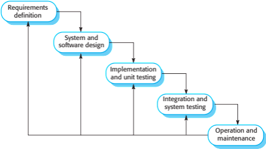
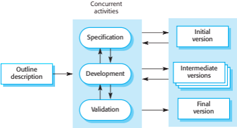
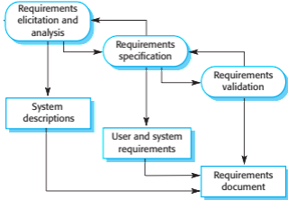
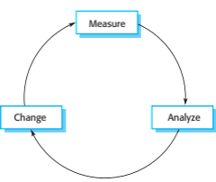
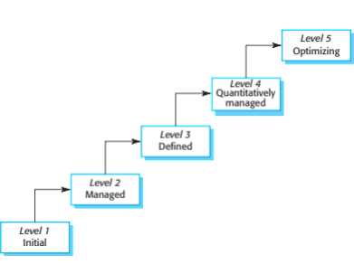
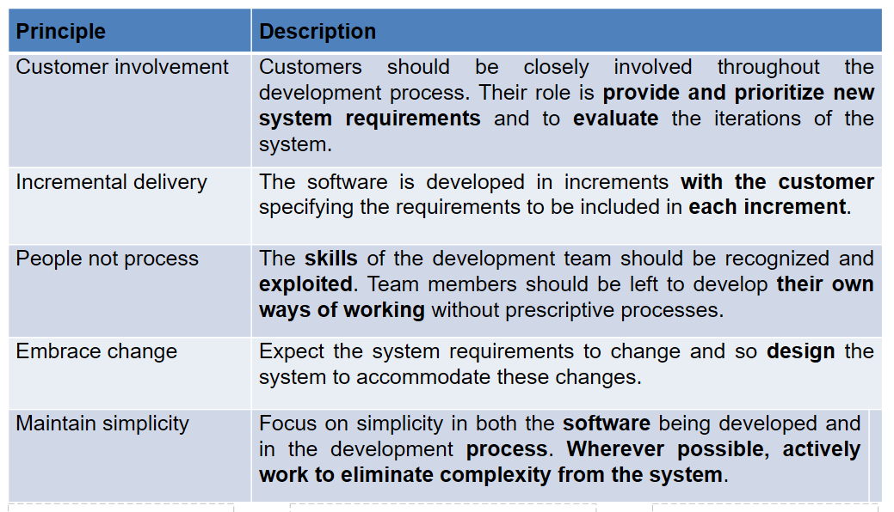
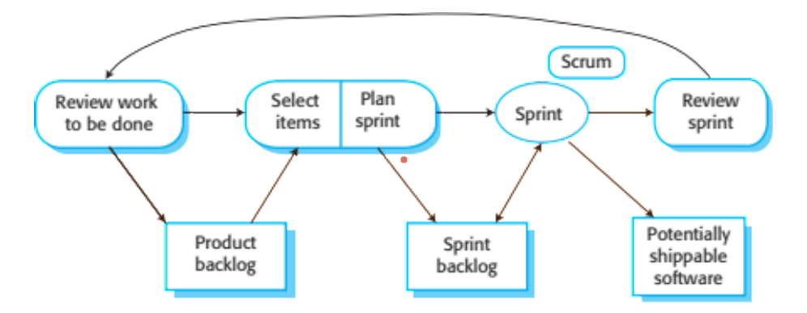
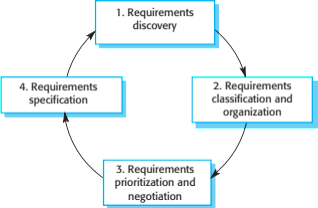

# Software Engineering Midterm Summarized

## Ethical Principles

1. **PUBLIC:** Software engineers shall act consistently with the public interest.

2. **CLIENT AND EMPLOYER:** Software engineers shall act in a manner that is in the best interests of their client and employer consistent with the public interest.

3. **PRODUCT:** Software engineers shall ensure that their products and related modifications meet the highest professional standards possible.

4. **JUDGMENT:** Software engineers shall maintain integrity and independence in their professional judgment.

5. **MANAGEMENT:** Software engineering managers and leaders shall subscribe to and promote an ethical approach to the management of software development and maintenance.

6. **PROFESSION:** Software engineers shall advance the integrity and reputation of the profession consistent with the public interest.

7. **COLLEAGUES:** Software engineers shall be fair to and supportive of their colleagues.

8. **SELF:** Software engineers shall participate in lifelong learning regarding the practice of their profession and shall promote an ethical approach to the practice of the profession.

### Software processes all involve:

1. **Specification:** Defining what the system should do.

2. **Design and implementation:** Defining the organization of the system and implementing the system.

3. **Validation:** Checking that it does what the customer wants.

4. **Evolution:** Changing the system in response to changing customer needs.

## Waterfall Model

> Waterfall modelinin temel dezavantajı, süreç başladıktan sonra değişikliklere uyum sağlamanın zor olmasıdır. Prensip olarak, bir sonraki aşamaya geçebilmek için mevcut aşamanın tamamlanmış olması gerekir.

## Incremental Development

> Incremental development (Artımlı Geliştirme), yazılımı tek seferde baştan sona bitirmek yerine parça parça (sürümler halinde) geliştirmeye dayanan bir yaklaşımdır. Waterfall modelinin tersine, tüm gereksinimleri baştan birebir sabitlemek zorunda kalmazsın; ortaya çalışan bir ilk sürüm çıkarır, gelen geri bildirimlere göre üzerine ekleyerek ilerlersin.

## Requirements Engineering Process

## Testing Stages

1. **Component testing:** Individual components are tested independently. 

2. **System testing:** Testing of the system as a whole.

3. **Customer testing:** Testing with customer data to check that the system meets the customer’s needs.

## Process Improvement Cycle

## Capability Maturity Levels

1. **Initial:**
Essentially uncontrolled.

2. **Repeatable:**
Product management procedures defined and used.

3. **Defined:**
Process management procedures and strategies defined and used.

4. **Managed:**
Quality management strategies defined and used.

5. **Optimising:**
Process improvement strategies defined and used.

## Rapid Software Development
Yazılımın mümkün olduğunca kısa sürede geliştirilmesini ve teslim edilmesini amaçlayan yaklaşımların genel adıdır.

## Plan-driven Development
Bu yaklaşımda yazılım geliştirme süreci önceden detaylı şekilde planlanır. Geliştirmeye başlamadan önce gereksinimler, tasarım, zaman çizelgesi ve yapılacak işler mümkün olduğunca belirlenir.

## Agile Development
Bu yaklaşımda yazılım, küçük ve tekrarlayan geliştirme döngüleri (iterations) içerisinde geliştirilir (RSD örneği).

### Agile Development Principles:

### Agile Development Techniques:
- **Extreme Programming**: Genel hatlarıyla Agile'ın yansıması, ekstra olarak Pair Programming (iki geliştiricinin aynı bilgisayarda çalışması) gibi yöntemleri kapsar.

## Scrum
Bir Agile framework'üdür. Temelde Agile prensiplerini belirli parçalar halinde yönetilebilir bir şekilde uygulamayı hedefler.

- **Sprint:** 1-4 haftalık geliştirme döngüsü.

- **Product Backlog:** Ürün için yapılması gereken tüm işlerin önceliklendirilmiş listesi.

- **Sprint Backlog:** Mevcut Sprint'te yapılması planlanan işler ve bunları gerçekleştirme planı.

- **Increment:** Sprint sonunda elde edilen, kullanılabilir ve tamamlanmış ürün çıktısı.

### Scrum Sprint Cycle:

## Requirements Engineering
Requirements Engineering (Gereksinim Mühendisliği), bir yazılım sisteminin hangi özelliklere sahip olması gerektiğini ve hangi kısıtlamalar altında çalışacağını belirleme, analiz etme, belgeleme, doğrulama ve yönetme sürecidir.

**Feasibility Studies**: A feasibility study is a short, focused study that should take place early in the RE process. It should answer three key questions:

1. Does the system contribute to the overall objectives of the organization? 

2. Can the system be implemented within schedule and budget using current technology? and 

3. Can the system be integrated with other systems that are used?

If the answer to any of these questions is no, you should probably not go ahead with the project.

### Requirements Classification:
1. **Functional Requirements (Fonksiyonel Gereksinimler):** Sistemin ne yapması gerektiğini tanımlar. Sistemin sunması gereken işlevleri ve davranışları belirtir.

    Örnekler:
    - Kullanıcı sisteme giriş yapabilmelidir.
    - Kullanıcı şifresini değiştirebilmelidir.
    - Sistem sipariş oluşturabilmelidir.

2. **Non-functional Requirements (Fonksiyonel Olmayan Gereksinimler):** Sistemin nasıl çalışması gerektiğini veya hangi kalite özelliklerine sahip olması gerektiğini tanımlar.

    Örnekler:
    - Sistem 2 saniyeden kısa sürede yanıt vermelidir. (Performance)
    - Kullanıcı şifreleri şifrelenmiş olarak saklanmalıdır. (Security)
    - Sistem aynı anda 10.000 kullanıcıyı desteklemelidir. (Scalability)

    Non-functional requirements kendi içinde de sınıflandırılabilir:
    1. **Product Requirements:** Ürünün performans, güvenilirlik ve kullanılabilirlik gibi özellikleri.

    2. **Organizational Requirements:** Organizasyonun belirlediği standartlar, politikalar ve geliştirme süreçleri.

    3. **External Requirements:** Sistem dışından gelen yasal, etik veya birlikte çalışabilirlik (interoperability) gereksinimleri.

3. **Domain Requirements (Alan Gereksinimleri):** Sistemin faaliyet gösterdiği belirli iş alanından (application domain) kaynaklanan gereksinimlerdir.

    Örnekler:
    - Bankacılık yazılımı finansal düzenlemelere uymalıdır.
    - Hastane yazılımı hasta kayıtlarını ilgili sağlık standartlarına uygun tutmalıdır.

### Requirements Elicitation:
Requirements Elicitation (Gereksinimlerin Elde Edilmesi), yazılım sisteminin gereksinimlerini belirlemek amacıyla müşterilerden, kullanıcılardan ve diğer paydaşlardan (stakeholders) bilgi toplama sürecidir.

#### Requirements Elicitation Process:

### Requirements Specification:
Requirements Specification (Gereksinimlerin Belirtilmesi), yazılım sisteminin gereksinimlerinin dökümente edilmesi sürecidir.

### Requirements Validation:
Requirements Validation (Gereksinimlerin Doğrulanması), belirlenen ve belgelenen yazılım gereksinimlerinin müşterinin ve kullanıcıların gerçek ihtiyaçlarını karşılayıp karşılamadığını kontrol etme sürecidir.

> Bunlara çalışın 100 alırsınız öptüm muah...